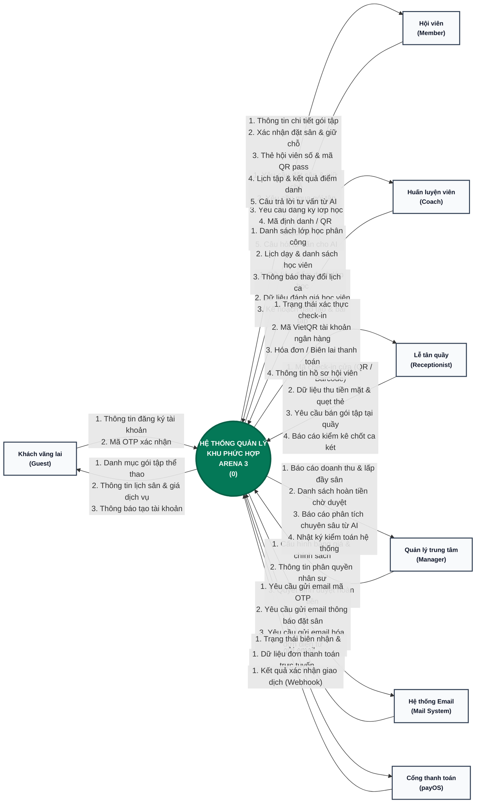
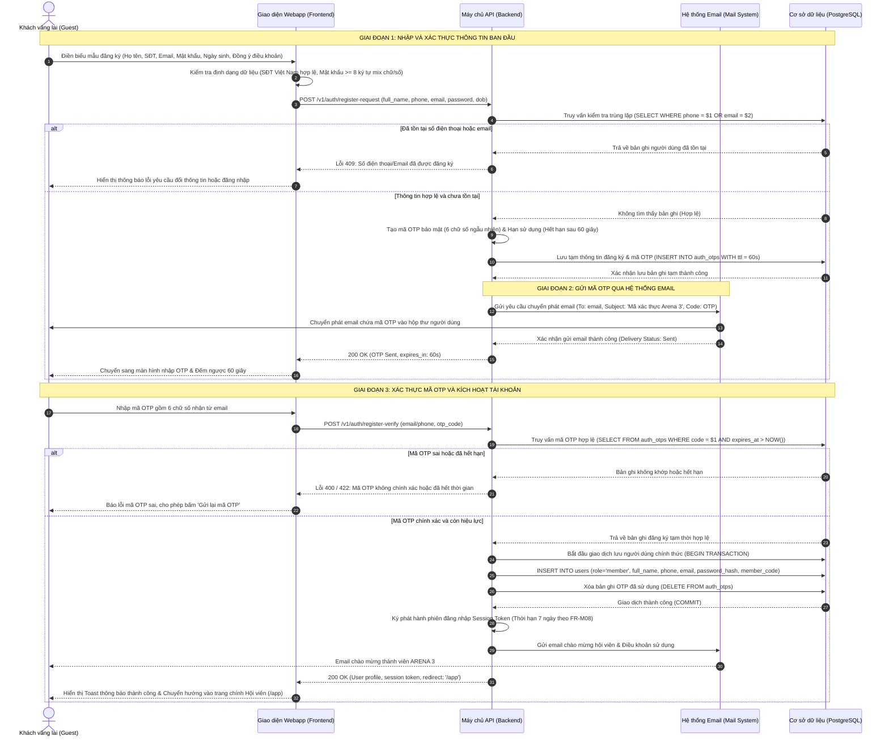

# Sơ Đồ Đặc Tả Yêu Cầu Phần Mềm (SRS Diagrams)
## Hệ Thống Quản Lý Khu Phức Hợp Thể Thao ARENA 3

Tài liệu này chuẩn hóa và cung cấp 3 sơ đồ cốt lõi theo phản hồi kiểm tra SRS (Google Sheet `SRS (gid=0)`):
1. **Use Case Diagram (Sơ đồ Use Case)**: Bổ sung đầy đủ các Actor: `AI Assistant`, `Mail System`, `Guest` cùng các mối quan hệ nghiệp vụ.
2. **Context Diagram (Sơ đồ Ngữ Cảnh DFD Cấp 0)**: Bổ sung External Entity `Mail System`, luồng `Member xem gói`, luồng `Coach đánh giá học viên`, và **toàn bộ luồng dữ liệu đều được chuẩn hóa thành DANH TỪ (Noun-based Data Flows)**.
3. **Swimlane Diagram (Sơ đồ Phân Làn Nghiệp Vụ)**: Mô tả chi tiết quy trình **Đăng ký tài khoản có xác thực mã OTP qua Mail System (Register with Mail OTP)** qua 5 làn thực thi.

---

## 1. Use Case Diagram (Sơ đồ Use Case tổng thể)

### 1.1 Danh sách Actor
- **Khách vãng lai (Guest)**: Khách hàng chưa đăng nhập tài khoản.
- **Hội viên (Member)**: Khách hàng đã đăng ký tài khoản thành viên.
- **Lễ tân (Receptionist)**: Nhân viên quầy đón tiếp, bán gói, thu tiền, check-in.
- **Huấn luyện viên (Coach)**: Nhân sự phụ trách lớp học, điểm danh, đánh giá tiến độ học viên.
- **Quản lý (Manager)**: Quản trị viên trung tâm, cấu hình giá, nhân sự, duyệt hoàn tiền, báo cáo.
- **Trợ lý AI (AI Assistant)**: Hệ thống AI tư vấn thông minh, phân tích dữ liệu.
- **Hệ thống Email (Mail System)**: Hệ thống bên ngoài cung cấp dịch vụ gửi email OTP, thông báo và hóa đơn.
- **Tiến trình lập lịch (Scheduler)**: Dịch vụ nền tự động hóa (giải phóng giữ chỗ, no-show, sinh ca lớp).

### 1.2 Biểu đồ Use Case (Mermaid)

```mermaid
flowchart TB
    %% Actors
    subgraph Actors_Group ["TÁC NHÂN (ACTORS)"]
        Guest["Khách vãng lai (Guest)"]
        Member["Hội viên (Member)"]
        Receptionist["Nhân viên Lễ tân (Receptionist)"]
        Coach["Huấn luyện viên (Coach)"]
        Manager["Quản lý (Manager)"]
        AI["Trợ lý AI (AI Assistant)"]
        MailSys["Hệ thống Email (Mail System)"]
        Scheduler["Tiến trình Lập lịch (Scheduler)"]
    end

    %% Use Cases Boundary
    subgraph Arena3_System ["HỆ THỐNG QUẢN LÝ ARENA 3"]
        direction TB

        %% Guest & Auth
        subgraph UC_Public ["Khách & Xác thực"]
            UC_G1(["UC-01: Xem lịch sân & sân trống"]):::uc
            UC_G2(["UC-02: Xem danh mục gói tập"]):::uc
            UC_G3(["UC-03: Đăng ký tài khoản"]):::uc
            UC_AUTH1(["UC-04: Xác thực mã OTP"]):::uc
            UC_AUTH2(["UC-05: Đăng nhập & Đổi mật khẩu"]):::uc
        end

        %% Member UCs
        subgraph UC_Member_Sub ["Nghiệp vụ Hội viên"]
            UC_M1(["UC-06: Đặt sân thể thao"]):::uc
            UC_M2(["UC-07: Mua gói tập (Ghi nhận pending)"]):::uc
            UC_M3(["UC-08: Đăng ký lớp học theo trình độ"]):::uc
            UC_M4(["UC-09: Xem lịch tập & chuyên cần"]):::uc
            UC_M5(["UC-10: Mở thẻ Pass / QR Code"]):::uc
            UC_M6(["UC-11: Trò chuyện & Nhận tư vấn từ AI"]):::uc
            UC_M7(["UC-12: Thanh toán trực tuyến payOS"]):::uc
        end

        %% Coach UCs
        subgraph UC_Coach_Sub ["Nghiệp vụ Huấn luyện viên"]
            UC_C1(["UC-13: Xem danh sách lớp được phân công"]):::uc
            UC_C2(["UC-14: Xem lịch dạy & học viên hôm nay"]):::uc
            UC_C3(["UC-15: Điểm danh học viên"]):::uc
            UC_C4(["UC-16: Đánh giá & nhận xét học viên"]):::uc
            UC_C5(["UC-17: Giao bài tập & lộ trình huấn luyện"]):::uc
        end

        %% Front Desk UCs
        subgraph UC_Desk_Sub ["Nghiệp vụ Lễ tân quầy"]
            UC_D1(["UC-18: Check-in cửa (Quét QR / Nhập mã)"]):::uc
            UC_D2(["UC-19: Bán gói tập tại quầy"]):::uc
            UC_D3(["UC-20: Thu tiền mặt & Xuất mã VietQR ngân hàng"]):::uc
            UC_D4(["UC-21: Đặt sân trực tiếp cho khách walk-in"]):::uc
            UC_D5(["UC-22: Mở & Đóng ca két tiền"]):::uc
            UC_D6(["UC-23: Yêu cầu hoàn tiền"]):::uc
        end

        %% Manager UCs
        subgraph UC_Manager_Sub ["Nghiệp vụ Quản trị"]
            UC_MN1(["UC-24: Cấu hình bảng giá & Quy định sân"]):::uc
            UC_MN2(["UC-25: Quản lý tài khoản nhân viên & HLV"]):::uc
            UC_MN3(["UC-26: Phê duyệt yêu cầu hoàn tiền"]):::uc
            UC_MN4(["UC-27: Xem báo cáo doanh thu & lấp đầy"]):::uc
            UC_MN5(["UC-28: Phân tích dự báo vận hành bằng AI"]):::uc
        end

        %% Background / External UCs
        subgraph UC_External_Sub ["Dịch vụ Hỗ trợ & Ngoại vi"]
            UC_E1(["UC-29: Gửi email mã OTP xác thực"]):::uc
            UC_E2(["UC-30: Gửi email xác nhận đặt sân & hóa đơn"]):::uc
            UC_E3(["UC-31: Giải phóng vị trí giữ chỗ quá hạn"]):::uc
            UC_E4(["UC-32: Tự động đánh dấu vắng mặt (No-show)"]):::uc
            UC_E5(["UC-33: Sinh ca học định kỳ từ RRule"]):::uc
        end
    end

    %% Guest Relations
    Guest --> UC_G1
    Guest --> UC_G2
    Guest --> UC_G3

    %% Include / Extend
    UC_G3 -.->|<<include>>| UC_AUTH1
    UC_AUTH1 -.->|<<include>>| UC_E1

    %% Member Relations
    Member --> UC_G1
    Member --> UC_G2
    Member --> UC_AUTH2
    Member --> UC_M1
    Member --> UC_M2
    Member --> UC_M3
    Member --> UC_M4
    Member --> UC_M5
    Member --> UC_M6
    UC_M1 -.->|<<extend>>| UC_M7
    UC_M2 -.->|<<extend>>| UC_M7
    UC_M1 -.->|<<include>>| UC_E2

    %% Coach Relations
    Coach --> UC_AUTH2
    Coach --> UC_C1
    Coach --> UC_C2
    Coach --> UC_C3
    Coach --> UC_C4
    Coach --> UC_C5

    %% Desk Relations
    Receptionist --> UC_AUTH2
    Receptionist --> UC_D1
    Receptionist --> UC_D2
    Receptionist --> UC_D3
    Receptionist --> UC_D4
    Receptionist --> UC_D5
    Receptionist --> UC_D6
    UC_D2 -.->|<<include>>| UC_D3

    %% Manager Relations
    Manager --> UC_AUTH2
    Manager --> UC_MN1
    Manager --> UC_MN2
    Manager --> UC_MN3
    Manager --> UC_MN4
    Manager --> UC_MN5

    %% AI Relations
    AI --> UC_M6
    AI --> UC_MN5

    %% Mail System Relations
    MailSys --> UC_E1
    MailSys --> UC_E2

    %% Scheduler Relations
    Scheduler --> UC_E3
    Scheduler --> UC_E4
    Scheduler --> UC_E5

    classDef uc fill:#ffffff,stroke:#1e293b,stroke-width:1.5px,color:#0f172a,font-size:12px;
```

---

## 2. Context Diagram (Sơ đồ Ngữ Cảnh DFD Cấp 0)

### 2.1 Quy tắc chuẩn hóa
- **Thực thể ngoài (External Entities)**: `Khách vãng lai (Guest)`, `Hội viên (Member)`, `Lễ tân (Receptionist)`, `Huấn luyện viên (Coach)`, `Quản lý (Manager)`, `Hệ thống Email (Mail System)`, `Cổng thanh toán trực tuyến (payOS)`.
- **Hệ thống trung tâm**: `Hệ Thống Quản Lý Thể Thao ARENA 3`.
- **Quy chuẩn luồng dữ liệu (Data Flows)**: **100% sử dụng CỤM DANH TỪ** (Noun Phrases), tuyệt đối không dùng động từ làm tên luồng dữ liệu.

### 2.2 Biểu đồ Ngữ Cảnh (Mermaid)

---

## 3. Swimlane Diagram (Sơ đồ Phân Làn Nghiệp Vụ)
### Quy trình: Đăng Ký Tài Khoản Có Xác Thực Mã OTP Qua Mail System (Register with Mail OTP)

### 3.1 Các làn thực thi (5 Lanes)
1. **Khách vãng lai (Guest)**: Nhập thông tin đăng ký, nhận email, nhập mã OTP.
2. **Giao diện Webapp (Frontend)**: Kiểm tra ràng buộc phía client, gửi API request, hiển thị bộ đếm OTP.
3. **Máy chủ API (Backend Server)**: Xử lý quy tắc nghiệp vụ (BR-01, BR-02, BR-07, BR-08), sinh mã OTP ngẫu nhiên, phát hành JWT token.
4. **Hệ thống Email (Mail System)**: Nhận bản tin gửi mail, định dạng mẫu email OTP, thực thi gửi tới hộp thư khách hàng.
5. **Cơ sở dữ liệu (Database)**: Kiểm tra số điện thoại/email tồn tại, lưu trữ mã OTP có thời hạn (TTL 60s), lưu trữ hồ sơ hội viên chính thức.

### 3.2 Biểu đồ Phân Làn (Mermaid Swimlane / Sequence Flow)

---

## 4. Tóm tắt Đối chiếu với Yêu cầu Thẩm định SRS (Verification Matrix)

| Yêu cầu phản hồi từ Sheet SRS | Hiện trạng đã xử lý | Vị trí minh chứng |
| --- | --- | --- |
| **Thêm actor AI Assistant** | Đã bổ sung Actor `AI Assistant`, với các Use Case tư vấn khách, gợi ý sân và phân tích vận hành. | Mục 1.1, 1.2, 2.1 |
| **Thêm actor Mail System** | Đã bổ sung External Entity `Mail System`, liên kết gửi OTP, email xác nhận và hóa đơn. | Mục 1.1, 1.2, 2.1, 2.2, 3.2 |
| **Thêm actor Guest** | Đã bổ sung Actor `Guest` (Khách vãng lai) với các Use Case xem sân, xem gói và đăng ký tài khoản. | Mục 1.1, 1.2, 2.1, 2.2 |
| **Context Diagram: Thêm luồng Member xem gói** | Đã bổ sung luồng: `Thông tin chi tiết gói tập` & `Danh mục gói tập thể thao` gửi tới Member. | Mục 2.2 (Member Flows) |
| **Context Diagram: Thêm luồng Coach đánh giá học viên** | Đã bổ sung luồng: `Dữ liệu đánh giá học viên` từ Coach gửi vào Hệ thống. | Mục 2.2 (Coach Flows) |
| **Context Diagram: Toàn bộ luồng là DANH TỪ** | 100% tên luồng trên sơ đồ và bảng mô tả là danh từ/cụm danh từ (Noun phrases). Không có động từ. | Mục 2.1, 2.2 |
| **Swimlane Diagram: Chi tiết đăng ký với Mail OTP** | Thiết kế sơ đồ 5 làn chi tiết đầy đủ từng bước từ nhập liệu, gửi OTP qua Mail System đến kích hoạt hội viên. | Mục 3.1, 3.2 |
